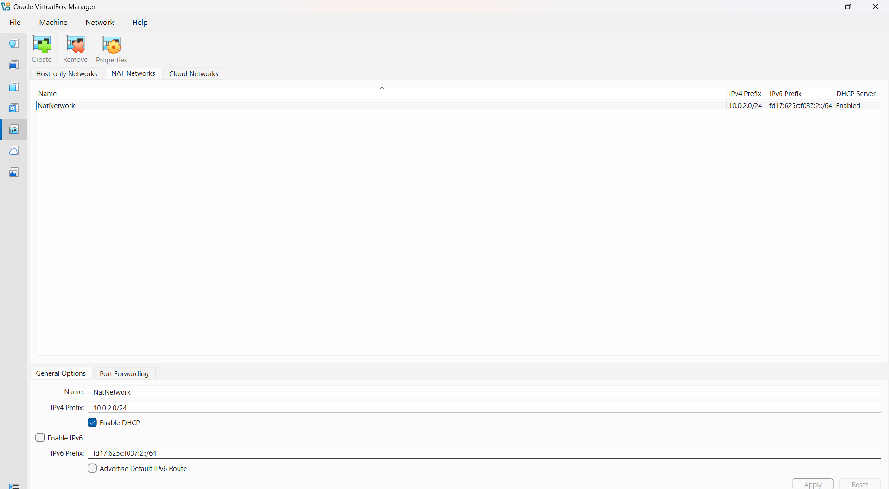
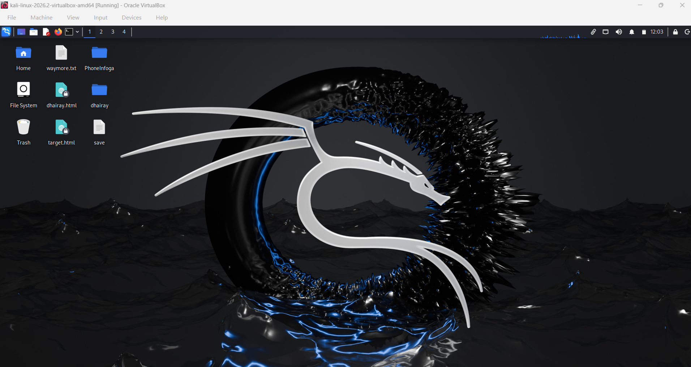
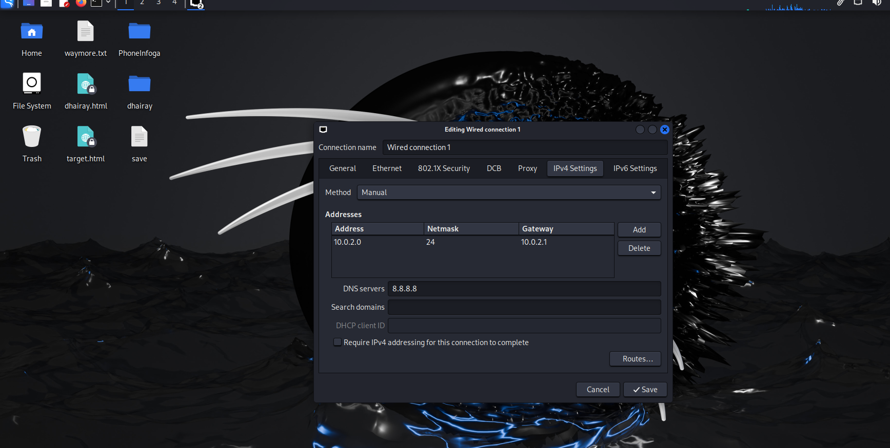

# Cybersecurity Lab Setup — Week 1

## Project Overview
This project documents my Week 1 cybersecurity lab setup as part of my cybersecurity learning journey.

The lab environment is created using Oracle VirtualBox and Kali Linux to understand virtual machines and network configuration.

## Objectives
- Set up a virtual lab environment.
- Configure a NAT Network in VirtualBox.
- Connect Kali Linux to the virtual network.
- Check IP address and network connectivity.
- Document the setup with screenshots.

## Tools Used
- Oracle VirtualBox
- Kali Linux
- Mozilla Firefox
- Terminal and basic network commands
## Lab Configuration

| Component | Configuration |
|---|---|
| Virtualization Software | Oracle VirtualBox |
| Operating System | Kali Linux |
| Network Mode | NAT Network |
| Network Name | NatNetwork |
| IPv4 Prefix | 10.0.2.0/24 |
| Subnet Mask | 255.255.255.0 |
| DHCP | Enabled |

## Lab Setup Screenshots

### 1. VirtualBox Network Configuration

### 2. Kali Linux Running

### 3. Kali Linux Network Configuration

## Verification
The lab configuration is checked using basic network commands:

- `ip a` — to view network interfaces and IP addresses.
- `ip route` — to check the routing table and default gateway.
- `ping -c 4 google.com` — to test connectivity and DNS resolution.

Actual results are documented through terminal screenshots.

## Learning Outcomes
- Learned the basics of VirtualBox networking.
- Understood NAT Network configuration.
- Practised checking IP addresses and routing information.
- Learned to document lab setup and verification results.

## Ethical Use
This lab is intended for educational purposes and authorized testing only.

## Author
Dhairay Kanojiia

Cybersecurity Internship — Week 1
<!-- 

 -->

## 🌐 Socials:
   

<!-- Proudly created with GPRM ( https://gprm.itsvg.in ) -->
